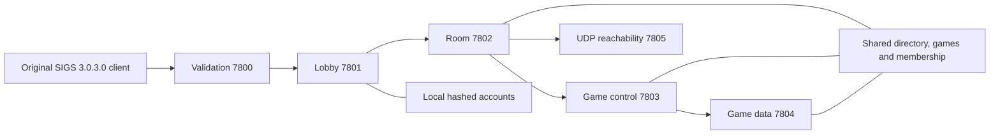

# Architecture and evidence

## Recovered boundaries

The supplied DLLs establish a length-framed message protocol, format registry,
and distinct validation, lobby, room and game connections. They do not establish
the original server's process layout, database schema or scheduler. This server
keeps the known service boundaries inside one process so room membership and
game readiness have one owner. A nonblocking event loop queues writes and keeps
slow receivers from blocking every client.

`src/core/` preserves the thirteen historical filenames identified by the client
revision strings: SNString, SNComMgr, MsgHdr, LstBlck, FrmtCtrl, SNGen, SNDate,
SNSocTCP, SNComSoc, Format, SNSockIP, ProcessMsg and MsgDef. Their C++ APIs and
responsibilities are modern replacements, not recovered original classes.
Core types use the `sigs::core` namespace; application services use
`sigs::server`. These namespaces follow the source folders while keeping
the core library and server as separate build targets.
The server uses the codec and TCP ownership layer directly; the original core's
synchronous CommunicationManager is retained for reference/tests but does not
schedule this server. One read-only native socket accessor was added to integrate
the event loop.

`src/server/Server.cpp` owns listeners, framing, bounded output queues, connections,
peer records, identity lookup, UDP probes and cleanup. `src/server/Services.cpp` owns
the service-specific state transitions. `src/server/Accounts.cpp` uses Windows BCrypt
for password derivation and random salts; `src/main.cpp` provides configuration
and offline account creation/reset. `src/server/Storage.cpp` persists membership,
profiles and complaints with atomic file replacement; `src/server/Updates.cpp` loads
exact update routes and checks their package hashes before binding listeners.
`src/server/Protocol.cpp` owns registry coverage and role-gated moderation. All state
is mutated on the event loop thread.

The reconstruction enforces 201-before-111 for remote player creation and
refreshes 111 after 411/412 because the client rebuilds player objects. Every
game owns a distinct roster and slot table even though games in a room share
transport listeners. Slot IDs remain stable until a member leaves. Admission
decisions are checked again when host approval or invitation acceptance arrives.
Pending requests expire after 120 seconds. Transport reconnection closes only
the old connection of the same role; losing data clears control readiness.

Room/control/data clients receive one 207 after 30 seconds without a complete
known packet and close after 90 seconds. Unidentified clients close after 30
seconds. These are emulator policies, not recovered Sierra constants. Lobby
connections have no invented application ping. Disconnecting a lobby closes
its owned room and transport sessions. Closing one malformed connection does
not terminate the server. Startup binds every main endpoint before serving.
Custom-room allocation rolls back if any listener fails to bind.
Used custom rooms retire when the last room connection has been removed.
Their listeners close and unaffected lobby clients receive 309. A lobby owner
that might still consider the room active keeps a deferred removal until 107
confirms another room's initialization. Its old name stays reserved meanwhile.

Update transfer uses the same bounded output queue as ordinary traffic. 617
requires a prior offer on that connection; blocks are at most 512 bytes and
are filled incrementally rather than queueing the entire package. Progress
refreshes the download timeout. Component transfer ends with 906 then 901;
game transfer ends with 906 and closure. No test executes a downloaded package.

SIERRANW.DLL SHA-256:
`f41ae063d7197eda7c012ef3c32810f62edcbd4d72f79a8ec1e5551cf77003c3`.
SNWVALID.DLL SHA-256:
`863c8fe7d44a28ca9f955235fd92bc4d31f496caf980205a4fd07028fdeec550`.
The reference binaries are included under `references/binaries/` for read-only
analysis. Local research dependencies and licenses are in `third_party/research/`,
which is ignored by Git along with the research scripts and saved evidence.
See [Git exclusions](version-control.md) for fresh-clone limitations.

Historical port numbers, a multiprocess topology and undiscovered message
semantics cannot be established from the available references. Ports, limits,
account storage, directory lifetime, host succession and scheduling here are
documented implementation choices.
